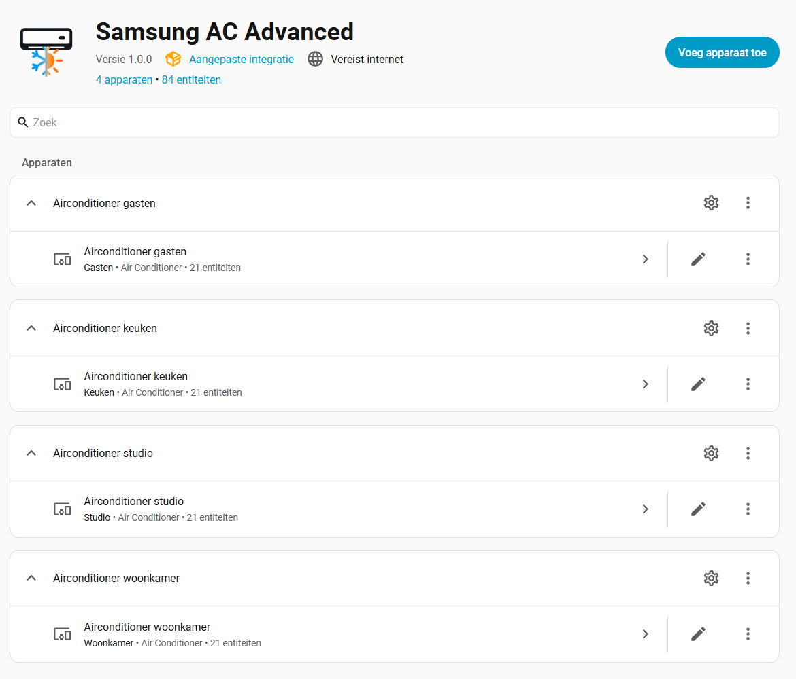
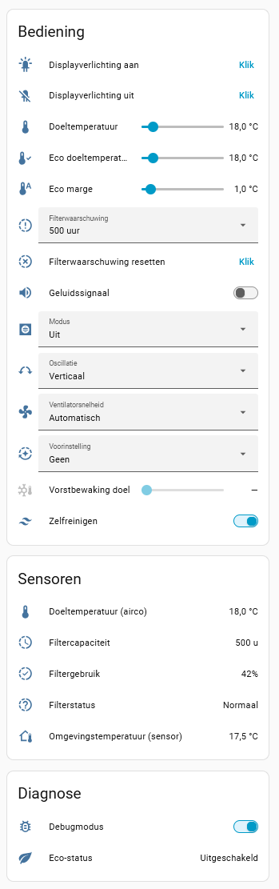
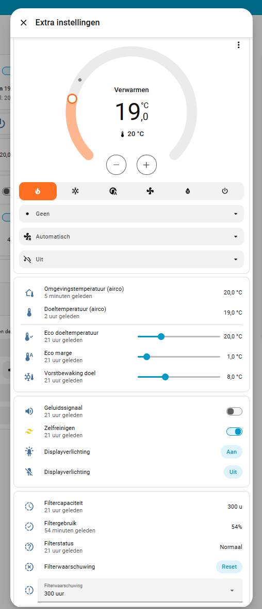

# Samsung AC Advanced

Samsung AC Advanced is an unofficial Home Assistant custom integration for Samsung air conditioners controlled through the SmartThings REST API. It adds Samsung-specific controls and higher-level thermal automation that are not exposed by the standard Home Assistant SmartThings climate entity.

Version **1.0.0** is the initial public release.

## Why this integration exists

The project started from a practical limitation: the standard SmartThings integration exposes the basic climate controls, but not every useful Samsung capability, and it does not provide the state ownership needed for more advanced room-temperature control.

Samsung AC Advanced therefore uses the SmartThings REST API directly and keeps one shared coordinator per configured air conditioner. This makes it possible to expose additional capabilities such as Quiet, self-cleaning, sound, display commands and filter information, while also supporting controller-owned features such as Eco and Frost Protection.

Eco is intentionally **not** a thin wrapper around a Samsung preset. It is a Home Assistant-side control strategy with its own target, hysteresis, temperature-source selection, Sleep/Stand-by behaviour and exact restore semantics. Frost Protection is a separate controller with a much smaller fixed profile. The two controllers are mutually exclusive.

Eco is primarily intended to work alongside Samsung's native climate control rather than replace it. In principle, however, it can also form the basis of a more Home Assistant-driven control setup when combined with the required third-party integrations and dashboard cards.

## Main features

- HVAC modes: Off, Auto, Cool, Heat, Dry and Fan only.
- Fan speeds: Auto, Low, Medium, High and Turbo.
- Vertical oscillation control.
- Samsung optional modes: None, Sleep, Boost and Quiet.
- Simulated **Eco** preset with controlled hysteresis, external/internal temperature-source support, Sleep/Stand-by routing and Original Snapshot restore.
- Simulated **Frost Protection** preset with adjustable target from 7.0 to 10.0 °C in 0.5 °C steps and fixed 1.0 °C hysteresis.
- Self-cleaning switch.
- Sound-effect switch.
- Stateless display-lighting On and Off buttons.
- Filter status, filter usage, filter capacity and configurable filter-warning threshold.
- Filter reminder reset button.
- Per-device Debug mode without a `configuration.yaml` logger override.
- Dutch and English entity translations.

## Usage and dashboard integration

Samsung AC Advanced is designed as an **additional control layer for Samsung air conditioners through SmartThings**. It is not intended as a replacement for Home Assistant's official SmartThings integration.

The integration exposes additional controls and settings that may not be available through the standard SmartThings climate entity. Its primary goal is to make those functions accessible in Home Assistant as individual entities and controls.

Because of this architecture, Samsung AC Advanced is **not primarily designed around Home Assistant's standard Thermostat Card**. The integration exposes a climate entity as well as separate entities for additional functions such as operating mode, fan speed, presets, oscillation and other supported features.

### Screenshots

Screenshots below show examples of Samsung AC Advanced in Home Assistant.

> Screenshots are examples only. Dashboard appearance and available controls may differ depending on the Samsung air-conditioner model, Home Assistant version, installed frontend integrations and personal dashboard configuration.

#### Integration overview

#### Native Samsung AC Advanced controls

#### Example with Template Climate

### Using Template Climate

Users who prefer a more traditional thermostat-style dashboard can optionally combine Samsung AC Advanced with the **Template Climate** integration developed by [jcwillox](https://github.com/jcwillox).

Template Climate can be used to create a virtual climate entity that maps the entities exposed by Samsung AC Advanced to a single thermostat-style entity. This makes it possible to use Home Assistant's Thermostat Card while still exposing additional Samsung AC Advanced functionality through supporting dashboard controls.

This approach can also be useful when combining the thermostat with third-party dashboard cards or other frontend integrations.

Samsung AC Advanced does **not** depend on Template Climate, and Template Climate is not required for normal operation.

> **Note**
>
> Template Climate is a separate third-party project. Configuration of Template Climate, custom dashboard cards and related frontend integrations is outside the scope of Samsung AC Advanced documentation and support.

## Eco

Eco uses one logical target temperature and one independent restart margin.

The logical target supports 0.5 °C steps. Samsung receives the required whole-degree physical setpoint, while the logical target remains the thermal-control threshold.

When Eco is active it owns the air conditioner's control sequence until the requested state has been coordinator-confirmed. Commands are serialized: one command is sent, the shared coordinator confirms the resulting SmartThings state, and only then may the next command be sent.

### Eco with an external temperature sensor

When a configured external room-temperature sensor is usable, reaching the Eco target allows the physical air conditioner to switch Off. Eco remains selected. When the restart threshold is crossed, the controller powers the unit back on and reconstructs the Eco profile serially.

### Eco with the internal Samsung sensor

When no usable external sensor is configured, Eco uses the Samsung room-temperature measurement. Because the internal sensor may not update normally while the unit is fully Off, Eco uses a low-power Stand-by profile instead of Sleep.

### Restore behaviour

Before Eco takes ownership, an Original Snapshot is captured. On a normal Eco exit, that snapshot is restored serially. If Eco Sleep is explicitly switched Off by the user, the snapshot can be retained as a deferred Pending Restore and applied on the next deliberate Power On.

## Frost Protection

Frost Protection is independent from Eco and is available only while the air conditioner is in Heat or physically Off.

- User target: 7.0–10.0 °C.
- Step: 0.5 °C.
- Fixed hysteresis: 1.0 °C.
- At or below the configured target: heating is required.
- At or above target + 1.0 °C: the physical air conditioner switches Off.
- Fixed heating profile: Heat, 16 °C physical target, Fan Auto, Oscillation Fixed, Samsung Optional Mode None.
- Sound/Beep, Display and Auto Clean are not changed by Frost Protection.
- The visible preset remains Frost Protection while the physical unit switches between Heat and Off.

The configured alternative Eco temperature sensor is also the preferred Frost Protection sensor. If it is unavailable or non-numeric, Frost Protection falls back to the Samsung internal temperature measurement.

## Debug mode

Each configured air conditioner has its own Debug mode switch.

When Debug mode is enabled, Samsung AC Advanced exposes useful coordinator, controller and capability-change diagnostics in the Home Assistant log. Routine successful coordinator fetch timing is filtered to keep the log readable. Warnings, errors and actual coordinator failures remain visible.

No Samsung AC Advanced logger entry is required in `configuration.yaml`.

Debug mode is intended for temporary diagnostics and can be disabled again after troubleshooting.

## Requirements

- Home Assistant.
- A Samsung air conditioner available in SmartThings.
- The SmartThings device ID.
- A SmartThings personal access token with permission to read and control the device.
- Internet access to the SmartThings cloud.

The integration was developed and tested primarily with a Samsung Room A/C reporting the SmartThings model identifier `ARTIK051_PRAC_20K`. Other Samsung air conditioners may expose different capabilities or normalize commands differently.

> **SmartThings authentication notice**
>
> Samsung has announced that affected legacy SmartThings Personal Access Tokens (PATs) expire on **December 15, 2026**. Version 1.0.0 uses PAT authentication. Continued operation after that date will require a future authentication migration or another supported SmartThings API access method. See `KNOWN_ISSUES.md`.

<!-- ha-marketplace:exclude-start -->

## Installation

### Home Assistant Marketplace

Until Samsung AC Advanced is included in the public Marketplace catalog, it can be added as a custom repository:

After adding the repository, install **Samsung AC Advanced** from the Marketplace.

### Manual installation

1. Back up any existing `/config/custom_components/samsung_ac_advanced/` directory.
2. Download the latest release from GitHub.
3. Copy `custom_components/samsung_ac_advanced/` to `/config/custom_components/`.
4. Remove any old `__pycache__` directories from the installed integration if present.
5. Restart Home Assistant completely.
6. Add **Samsung AC Advanced** from **Settings → Devices & services → Add integration**.
7. Enter the SmartThings device ID and personal access token when adding a new air conditioner.

<!-- ha-marketplace:exclude-end -->

## Configuration

After setup, open the integration's options to optionally select an alternative temperature sensor. The same configured sensor is used by Eco and Frost Protection. If no suitable alternative sensor is configured, the Samsung internal temperature measurement is used.

Most exposed entities are enabled by default. Home Assistant's entity registry can be used to rename, disable or reorganize them for a dashboard.

## Compatibility and device behaviour

Samsung firmware and SmartThings capabilities vary by model. Samsung may also normalize some requested combinations; for example, the device may change a fan setting when an optional mode is selected. Samsung AC Advanced treats confirmed coordinator state as authoritative unless a controller-owned transition is still in progress.

The integration deliberately avoids generic retry/backoff loops. Controller transitions use bounded ownership and coordinator confirmation instead of repeatedly re-sending commands.

## Known limitations

- Display-lighting commands do not provide reliable readable SmartThings state, so separate stateless On and Off buttons are used.
- Horizontal oscillation is not exposed for the original test model because that model does not physically support it, even when SmartThings metadata may advertise a broader oscillation option.
- Compatibility with Samsung models other than the main test model is not yet guaranteed and depends on community testing and feedback.
- SmartThings cloud availability, latency and API behaviour remain external dependencies.
- Version 1.0.0 uses legacy SmartThings PAT authentication; affected PATs are scheduled to expire on December 15, 2026.

See `KNOWN_ISSUES.md` for the release-level compatibility notes.

## Community and future development

Samsung AC Advanced originated as a private Home Assistant project created to solve limitations encountered with the developer's own Samsung air conditioners and the SmartThings integration.

The project is being shared publicly so that the experience, architecture and additional controls developed for that purpose may also be useful to others.

Continued development is not guaranteed and will primarily depend on the developer's own needs and available time. Support for additional Samsung models, new features and broader compatibility will therefore depend largely on community testing, feedback and contributions.

## Project architecture

`PROJECT.md` documents the controller architecture, ownership rules, restore model and design rationale for contributors and advanced users.

## Project status

Version 1.0.0 is the initial public release. Future development is not guaranteed and depends primarily on the developer's own needs, available time and community interest.

## Disclaimer

Samsung AC Advanced is an independent, unofficial project. It is not affiliated with, endorsed by or supported by Samsung Electronics, SmartThings or the Home Assistant project.

The integration has been developed with AI-assisted coding, analysis and documentation, combined with extensive manual testing against real hardware and Home Assistant behaviour.
